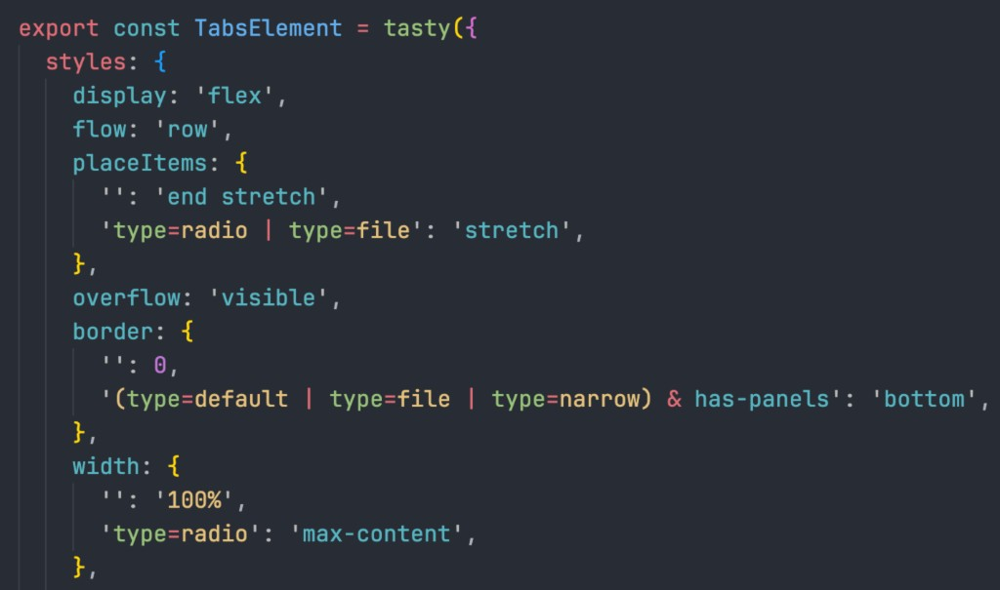

<p align="center">
  
</p>

<h1 align="center">Tasty</h1>

<p align="center">
  <strong>CSS-in-JS for React design systems.</strong><br />
  Build components whose styles don’t fight.
</p>

<p align="center">
  <a href="https://www.npmjs.com/package/@tenphi/tasty"></a>
  <a href="https://github.com/tenphi/tasty/actions/workflows/ci.yml"></a>
  <a href="https://github.com/tenphi/tasty/blob/main/LICENSE"></a>
</p>

---

Tasty is a styling engine for teams that build component libraries. You describe hover, disabled, variants, themes, and breakpoints as **state maps**, in a CSS-like language built from your design system's own tokens and conventions. Tasty compiles each map into selectors that never match at the same time, so the result never depends on specificity or source order.

```tsx
import { tasty } from '@tenphi/tasty';

const Button = tasty({
  as: 'button',
  styles: {
    fill: {
      '': '#primary',
      ':hover': '#primary-hover',
      ':active': '#primary-pressed',
      '[disabled]': '#surface',
    },
  },
});
```

Later keys have higher priority. If this button is both hovered and disabled, `[disabled]` wins and the hover rule does not apply. That decision is compiled into the selectors themselves, so you can add states, variants, themes, and overrides without reopening selector logic by hand.

- **Ready to try it?** Follow [Getting Started](docs/getting-started.md).
- **Evaluating fit?** Read [Comparison](docs/comparison.md) and the [Adoption Guide](docs/adoption.md).
- **Building a component library?** See [Methodology](docs/methodology.md) and [Building a Design System](docs/design-system.md).

## Why Tasty

- **States that can't conflict** — Every state map compiles into mutually exclusive selectors, and the last matching key wins by construction. Adding a state, variant, or override never means re-deriving selector interactions. [How it works →](#how-it-works)
- **Your design system's language** — Define color tokens, units, state aliases like `@mobile` and `@dark`, typography presets, and recipes once with `configure()`. Components then read like the spec: `padding: '2x'`, `fill: '#surface'`, `preset: 'h3'`. [Design-system integration →](#design-system-integration)
- **Typed component APIs** — Decide exactly what consumers can change. `styleProps`, `modProps`, `tokenProps`, `variants`, and sub-elements become typed React props and components with full autocomplete. [Component API →](#component-api)
- **Guardrails in the editor and CI** — An ESLint and oxlint plugin with 40+ rules checks property names, values, tokens, state keys, presets, and recipes against your project's config. TypeScript augmentation autocompletes your own token, preset, and theme names. [Types and linting →](#types-and-linting)
- **Modern CSS, one model** — Media and container queries, `@supports`, `:has()`, root and parent states, and `@starting-style` are all state keys. `@keyframes`, `@property`, `@font-face`, `@counter-style`, and `@function` are built in. [CSS coverage →](#css-coverage)
- **Render anywhere** — The same styles work in client React, React Server Components, and streaming SSR (Next.js, Astro). Render only on the server to ship no styling runtime at all, or extract CSS at build time with `tastyStatic()`. [Rendering modes →](#rendering-modes)

## Installation

```bash
pnpm add @tenphi/tasty
```

Requires Node.js 20+ and React 18+ (a peer dependency of the React entry points). `npm add @tenphi/tasty` and `yarn add @tenphi/tasty` work the same way.

## Quick Start

### 1. Write a component

Plain CSS values work as-is, so a first component looks like CSS you already know:

```tsx
import { tasty } from '@tenphi/tasty';

const Card = tasty({
  as: 'div',
  styles: {
    display: 'flex',
    flow: 'column', // flex-flow
    padding: '24px',
    gap: '12px',
    fill: 'white', // background-color
    color: '#222',
    border: '1px solid #ddd',
    radius: '12px', // border-radius
  },
});

<Card>Hello World</Card>;
```

### 2. Bring in your design system

Call `configure()` once, before your app renders, to define the vocabulary every component shares:

```tsx
// tasty.setup.ts — import it at the top of your entry point
import { configure } from '@tenphi/tasty';

configure({
  tokens: {
    '#surface': { '': '#fff', '@dark': '#1c1c1e' },
    '#text': { '': '#222', '@dark': '#f2f2f7' },
    '#border': '#ddd',
  },
  units: { x: '8px', r: '12px' }, // spacing step and radius
  states: {
    '@mobile': '@media(w < 768px)',
    '@dark':
      '@root(schema=dark) | (!@root(schema) & @media(prefers-color-scheme: dark))',
  },
});
```

The same card, written in that vocabulary:

```tsx
const Card = tasty({
  styles: {
    display: 'flex',
    flow: 'column',
    padding: { '': '3x', '@mobile': '2x' }, // 24px, 16px on mobile
    gap: '1.5x', // 12px
    fill: '#surface', // var(--surface-color)
    color: '#text',
    border: true, // 1bw solid #border
    radius: '1r', // 12px
  },
});
```

The component never mentions dark mode, yet it follows the `@dark` tokens. Change a token or a unit once and every component follows.

### 3. Add states and a typed API

```tsx
const Button = tasty({
  as: 'button',
  modProps: { isLoading: Boolean, size: ['sm', 'md', 'lg'] as const },
  styles: {
    padding: { '': '1.5x 3x', 'size=sm': '1x 2x', 'size=lg': '2x 4x' },
    radius: '1r',
    fill: {
      '': '#primary',
      ':hover': '#primary-hover',
      ':active': '#primary-pressed',
      disabled: '#surface',
    },
    color: { '': '#on-primary', disabled: '#text.40' },
    cursor: { '': 'pointer', isLoading: 'wait', disabled: 'not-allowed' },
    transition: 'theme',
  },
});

<Button size="lg" isLoading>
  Save
</Button>;
// renders <button data-is-loading data-size="lg" class="…">
```

`size` is typed as `'sm' | 'md' | 'lg'`. Mod props become `data-*` attributes, which state keys like `size=lg` and `isLoading` select. `disabled` tracks the native `disabled` prop, `#text.40` is the text color at 40% opacity, and `transition: 'theme'` is a named group that transitions color, background, border, shadow, outline, and opacity together.

### 4. Extend a component

```tsx
const DangerButton = tasty(Button, {
  styles: {
    fill: {
      '': '#danger',
      ':hover': '#danger-hover',
      ':active': '#danger-pressed',
      disabled: '@inherit', // keep the parent's disabled branch
    },
  },
});
```

A state map with a `''` key replaces the parent's map; a map without one extends it. `@inherit` pulls a single branch from the parent, `null` removes one, and `false` blocks it entirely. See [Extending vs. replacing state maps](docs/dsl.md#extending-vs-replacing-state-maps). An extension can also declare its own `styleProps`, `modProps`, `tokenProps`, `variants`, and `elements`, and it keeps the base's sub-elements.

[Getting Started](docs/getting-started.md) continues from here with setup, linting, editor tooling, and choosing a rendering mode.

## How It Works

The cascade resolves conflicts by specificity, then by source order. Take two rules for a button's background:

```css
.btn:hover {
  background: dodgerblue;
}
.btn[disabled] {
  background: gray;
}
```

Both selectors have specificity `(0, 2, 0)`. When the button is hovered **and** disabled, both match and the later rule wins. Swap the two rules and a hovered disabled button silently turns blue. The logic is correct; only the order is wrong, which is why this class of bug survives code review.

Tasty removes the competition. For the same intent:

```tsx
fill: {
  '': '#primary',
  ':hover': '#primary-hover',
  '[disabled]': '#surface',
}
```

it generates:

```css
.t0.t0:where(:not([disabled]):not(:hover)) {
  background-color: var(--primary-color);
}
.t0.t0:where(:not([disabled]):hover) {
  background-color: var(--primary-hover-color);
}
.t0.t0:where([disabled]) {
  background-color: var(--surface-color);
}
```

Each branch is guarded by the negation of every higher-priority branch, so exactly one rule matches any element. Reorder the rules, split them across stylesheets, or extend the component: the outcome stays the same. Because the logic stays in CSS rather than JavaScript, the browser handles layout, painting, and transitions natively.

<details>
<summary><strong>A harder case: dark mode from a root attribute or the OS preference</strong></summary>

Say `@dark` means "the root has `data-schema="dark"`, or no schema is set and the OS prefers dark":

```tsx
const Text = tasty({
  styles: {
    color: {
      '': '#text',
      '@dark': '#text-on-dark',
    },
  },
});
```

A first attempt by hand:

```css
.t0 {
  color: var(--text-color);
}
:root[data-schema='dark'] .t0 {
  color: var(--text-on-dark-color);
}
@media (prefers-color-scheme: dark) {
  .t0 {
    color: var(--text-on-dark-color);
  }
}
```

The `@media` branch fires even when `data-schema="light"` is set explicitly. Scoping it to `:root:not([data-schema])` fixes that, but the bare `.t0` default still matches unconditionally, and it can beat the attribute selector by source order if another rule re-declares it later. No single selector says "apply the default only when none of the dark branches win". The correct version negates every other branch, which is what Tasty generates:

```css
/* Explicit dark schema */
:where(:root[data-schema='dark']) .t0.t0 {
  color: var(--text-on-dark-color);
}

/* No schema attribute, OS prefers dark */
@media (prefers-color-scheme: dark) {
  :where(:root:not([data-schema])) .t0.t0 {
    color: var(--text-on-dark-color);
  }
}

/* Default: OS prefers light, schema is not dark */
@media (not (prefers-color-scheme: dark)) {
  :where(:root:not([data-schema='dark'])) .t0.t0 {
    color: var(--text-color);
  }
}

/* Default: OS prefers dark, but a non-dark schema is set */
@media (prefers-color-scheme: dark) {
  :where(:root:not([data-schema='dark'])[data-schema]) .t0.t0 {
    color: var(--text-color);
  }
}
```

That is one property with one state. Multiply it by dozens of properties, breakpoints, and container queries, and hand-written selectors stop being maintainable.

</details>

For the full compiler model (parsing state keys, building exclusive conditions, merging by value, materializing selectors and at-rules), see the [Style rendering pipeline](docs/pipeline.md). [Try it in the playground →](https://tasty.style/playground)

## Design-System Integration

`configure()` is where a design system's vocabulary lives. Everything defined there is available to every component, and the same names feed the linter and TypeScript.

| Define                       | With `configure({ … })`                                 | Use in styles                                            |
| ---------------------------- | ------------------------------------------------------- | -------------------------------------------------------- |
| Color tokens                 | `tokens: { '#surface': '#fff' }`                        | `fill: '#surface'`, `color: '#text.60'`                  |
| Value tokens                 | `tokens: { '$sidebar-width': '280px' }`                 | `width: '$sidebar-width'`                                |
| Units                        | `units: { x: '8px', r: '6px' }`                         | `padding: '2x'`, `radius: '1r'`                          |
| State aliases                | `states: { '@mobile': '@media(w < 768px)' }`            | `gap: { '': '2x', '@mobile': '1x' }`                     |
| Typography presets           | `presets: { h1: { fontSize: '2rem', … } }`              | `preset: 'h1'`                                           |
| Recipes                      | `recipes: { card: { padding: '4x', … } }`               | `recipe: 'card'`                                         |
| Global at-rules              | `keyframes`, `properties`, `fontFaces`, `counterStyles` | `animation: 'fade-in 200ms'`                             |
| Functions, handlers, plugins | `functions`, `handlers`, `propHandlers`, `plugins`      | `$$name(...)`, new style properties, new component props |

Tokens accept state maps, so a theme is just more branches: `'#surface': { '': '#fff', '@dark': '#1c1c1e' }`. To generate whole light, dark, and high-contrast palettes with contrast solving, use [Glaze](#glaze).

### Built-in units

| Unit | Default             | Example                  |
| ---- | ------------------- | ------------------------ |
| `x`  | `8px` spacing step  | `2x` → `16px`            |
| `r`  | `6px` radius        | `1r` → `6px`             |
| `cr` | `10px` card radius  | `1cr` → `10px`           |
| `bw` | `1px` border width  | `2bw` → `2px`            |
| `ow` | `3px` outline width | `1ow` → `3px`            |
| `sf` | stable fraction     | `1sf` → `minmax(0, 1fr)` |

Units compile to plain values. Override them with `configure({ units })`. When the scale has to change at runtime, point a unit at a custom property and define it as a token: `units: { x: 'var(--gap)' }` with `tokens: { $gap: '8px' }` makes `2x` compile to `calc(2 * var(--gap))`. Parentheses become `calc()`: `width: '(100% - 4x)'`.

### Recipes

Recipes are reusable style bundles, state maps included:

```tsx
configure({
  recipes: {
    card: { padding: '4x', fill: '#surface', radius: '1r', border: true },
    elevated: { shadow: '0 1x 3x #shadow' },
  },
});

const Panel = tasty({ styles: { recipe: 'card elevated', gap: '2x' } });
```

Local styles merge over recipes with the same extend/replace rules as component extension. Recipes listed after `/` apply after local styles, and `none` skips base recipes. See [Style DSL — Recipes](docs/dsl.md#recipes).

For token vocabularies, state aliases, layout primitives, and override contracts, see [Building a Design System](docs/design-system.md). To add your own style properties, units, functions, or component props, see [Plugins & Extension Points](docs/plugins.md).

## Component API

A Tasty component's public API is something you design. Instead of handing consumers an open `styles` escape hatch, expose the knobs they need as typed props.

### Style props

`styleProps` turns selected style properties into props. They accept state maps, so responsive values use the same syntax:

```tsx
import { tasty, FLOW_STYLES } from '@tenphi/tasty';

const Space = tasty({
  styles: { display: 'flex', flow: 'column', gap: '1x' },
  styleProps: FLOW_STYLES,
});

<Space flow="row" gap={{ '': '2x', '@mobile': '1x' }} />;
```

### Mod props

`modProps` exposes modifiers as typed props (`<Button isLoading size="lg">`, as in the [Quick Start](#3-add-states-and-a-typed-api)). Use `Boolean`, `String`, `Number`, or a `const` array of allowed values.

### Token props

`tokenProps` handles values that change often, such as progress, user-picked colors, or measured sizes. They set custom properties inline, so the class name and the CSS stay the same while the value changes:

```tsx
const Progress = tasty({
  tokenProps: ['progress', 'accentColor'] as const,
  styles: { width: '$progress', fill: '#accent' },
});

<Progress progress="75%" accentColor="#purple" />;
// style="--progress:75%;--accent-color:var(--purple-color)"
```

### Variants

Variants are named style sets. `variant` is typed from their keys, `default` (or the variant named by the `variant` option) applies when no `variant` is passed, and only the variants actually rendered emit CSS:

```tsx
const Badge = tasty({
  styles: { padding: '.5x 1x', radius: '1r' },
  variants: {
    default: { fill: '#surface', color: '#text' },
    danger: { fill: '#danger', color: '#on-danger' },
  },
});

<Badge variant="danger">Failed</Badge>;
```

### Sub-elements

Compound components style their inner parts from one definition. `elements` produces typed sub-components:

```tsx
const Card = tasty({
  styles: {
    padding: '4x',
    Title: { preset: 'h3', color: { '': '#text', ':hover': '#primary' } },
    Content: { color: '#text' },
  },
  elements: { Title: 'h3', Content: 'div' },
});

<Card>
  <Card.Title>Revenue</Card.Title>
  <Card.Content>Up 12% this week</Card.Content>
</Card>;
```

Sub-elements share the root's state context: `:hover` inside `Title` means "when the card is hovered". Use `@own(...)` when a part should react to its own state, and the `$` selector affix for precise descendant targeting.

All of these are covered in [React API](docs/react-api.md). For guidance on what to expose and when, see [Methodology](docs/methodology.md).

## Types and Linting

### TypeScript

Component props are typed from their definitions: `modProps` value lists become unions, `variant` is typed from the variant keys, style props are typed like the styles they expose, and sub-elements are typed components. Register your design system's names to get autocomplete inside style values too:

```ts
// tasty.d.ts
import '@tenphi/tasty';

declare module '@tenphi/tasty' {
  // '#surface', '#primary.50' in fill, color, and other color props
  interface TastyNamedColors {
    surface: true;
    primary: true;
  }
  // preset: 'h1'
  interface TastyPresetNames {
    h1: true;
    t2: true;
  }
  // <Button theme="danger" />
  interface TastyThemeNames {
    danger: true;
  }
}
```

`StylesInterface`, `TastyCustomProps`, and `TastyBaseStylePropNames` type the style properties, component props, and base style props your plugins add. See [Configuration → TypeScript](docs/configuration.md#typescript).

### ESLint and oxlint

[`@tenphi/eslint-plugin-tasty`](https://github.com/tenphi/eslint-plugin-tasty) validates style objects and JSX style props at lint time:

```bash
pnpm add -D @tenphi/eslint-plugin-tasty
```

```js
// eslint.config.js
import tasty from '@tenphi/eslint-plugin-tasty';

export default [tasty.configs.recommended]; // or tasty.configs.strict
```

A `tasty.config.ts` at the project root tells the plugin what your design system defines:

```ts
// tasty.config.ts
export default {
  tokens: ['#surface', '#text', '#primary', '$sidebar-width'],
  states: ['@mobile', '@dark'],
  presets: ['h1', 'h2', 't1', 't2'],
  recipes: ['card', 'elevated'],
  importSources: ['@my-org/ui'], // modules that re-export tasty()
};
```

With that in place, `recommended` catches:

- Typos in property names (checked against the full CSS property set) and malformed values
- Unknown color tokens, units, presets, and recipes (plus `$` tokens and state aliases in `strict`)
- Invalid state keys, missing `''` defaults, nested state maps, and `!important`
- Raw colors and pixel lengths where tokens belong, and non-idiomatic syntax such as `calc(...)` or `display: 'none'`, some with autofixes
- `style`, `className`, and instance `styles` on Tasty components, in favor of their typed API
- Bad values in JSX style props, such as `<Box fill="red" gap="17px" />`

The same rule sets run under oxlint. See the [plugin README](https://github.com/tenphi/eslint-plugin-tasty) for every rule and option.

## CSS Coverage

Every style property accepts a state map, and every kind of condition is a state key:

| State type       | Syntax                     | CSS output                          |
| ---------------- | -------------------------- | ----------------------------------- |
| Boolean modifier | `loading`                  | `[data-loading]`                    |
| Value modifier   | `theme=danger`             | `[data-theme="danger"]`             |
| Pseudo-class     | `:hover`                   | `:hover`                            |
| Attribute        | `[aria-selected="true"]`   | `[aria-selected="true"]`            |
| Class            | `.is-active`               | `.is-active`                        |
| Media query      | `@media(w < 768px)`        | `@media (width < 768px)`            |
| Container query  | `@(panel, w >= 300px)`     | `@container panel (width >= 300px)` |
| Root state       | `@root(schema=dark)`       | `:root[data-schema="dark"]`         |
| Parent state     | `@parent(theme=danger)`    | `:is([data-theme="danger"] *)`      |
| Structural       | `:has(> Icon)`             | `:has(> [data-element="Icon"])`     |
| Feature query    | `@supports(display: grid)` | `@supports (display: grid)`         |
| Entry animation  | `@starting`                | `@starting-style`                   |

Combine them with `&` (and), `|` (or), `!` (not), and `^` (xor): `'theme=danger & :hover'`. The `_` key sets a fallback floor for queries a browser may evaluate as unknown. See [Style DSL](docs/dsl.md).

At-rules live next to the styles that use them:

```tsx
const Spinner = tasty({
  styles: {
    '@keyframes': { spin: { to: { transform: 'rotate(360deg)' } } },
    animation: 'spin 1s linear infinite',
  },
});
```

- **`@keyframes`**: inline, as above, or global via `configure({ keyframes })`.
- **`@property`**: inferred automatically when a custom property gets a concrete value, so custom properties can transition and animate with no boilerplate. Declare one explicitly to change `inherits` or the initial value.
- **`@font-face`** and **`@counter-style`**: in styles, in `configure()`, or with the matching style function.
- **`@function`**: define parameterized CSS functions as `$$name` and call them anywhere a value is accepted. An opt-in polyfill inlines the calls for browsers that do not support it yet.

Tasty also ships its own style properties (`fill`, `flow`, `radius`, `preset`, `fade`, `scrollbar`, `hide`, and more), documented in [Style Properties](docs/styles.md). `@layer` and `!important` are intentionally left out: they would bring back the priority fights that state maps remove.

### Style functions

When you don't need a component, call the style functions directly: `useStyles` for a class name, `useGlobalStyles` for selector-scoped global CSS, `useRawCSS` for raw rules, plus `useKeyframes`, `useProperty`, `useFontFace`, `useCounterStyle`, and `useFunction`. All of them work in React Server Components. Apart from `useStyles`, which reads React context on the client, they are plain functions despite the `use` prefix, so they also work outside React; `computeStyles` is the hook-free equivalent of `useStyles`. See [React API — Style Functions](docs/react-api.md#style-functions).

## Rendering Modes

The DSL, tokens, units, state maps, and recipes are the same everywhere. What changes is where CSS is generated:

| Approach                  | Authoring API                               | CSS is generated                    | Tasty runtime in the browser | Best for                                                         |
| ------------------------- | ------------------------------------------- | ----------------------------------- | ---------------------------- | ---------------------------------------------------------------- |
| **Server-only React**     | `tasty()` plus `@tenphi/tasty/ssr/*`        | During server or static rendering   | None                         | Astro without islands, server-only RSC, SSG                      |
| **Hydrated React**        | `tasty()` plus `@tenphi/tasty/ssr/*`        | During SSR, then on demand in React | Only in hydrated components  | Interactive React apps, Next.js client components, Astro islands |
| **Build-time extraction** | `tastyStatic()` from `@tenphi/tasty/static` | During the build                    | None in file mode            | Non-React frameworks, CSS needed before rendering                |

- **`tasty()` renders on the server.** Components are hook-free and render as React Server Components by default. Rendered only on the server, they keep the full React API (`styleProps`, sub-elements, variants) and ship no styling runtime. Astro's `tastyIntegration({ islands: false })` is the verified zero-JavaScript setup; server-only Next.js RSC follows the same architecture. Without an integration, each element inlines its own CSS, and configured tokens, global styles, and Tasty's default `@property` set are not emitted (Tasty warns in development), so use one for anything that relies on `configure()` or on those defaults.
- **SSR integrations** add CSS batching, cross-tree deduplication, FOUC prevention, and client cache hydration for apps that also render on the client: `TastyRegistry` from `@tenphi/tasty/ssr/next` (plus `withTastyNext()` from `@tenphi/tasty/ssr/next-config` for a shared global stylesheet), `tastyIntegration()` from `@tenphi/tasty/ssr/astro`, and a core API for other React SSR setups. Streaming is supported.
- **`tastyStatic()`** returns class names and extracts CSS during the build through a Babel plugin, with no React dependency. File mode ships no runtime; inject mode ships a tiny CSS injector.

See [Server-Side Rendering](docs/ssr.md), [Build-Time Extraction](docs/tasty-static.md), and [Choosing a rendering mode](docs/getting-started.md#choosing-a-rendering-mode).

## Tooling

### ESLint plugin

Covered in [Types and Linting](#eslint-and-oxlint): 40+ rules for ESLint 9+ and oxlint, configured from `tasty.config.ts`.

### VS Code extension

[Tasty for VS Code](https://github.com/tenphi/tasty-vscode-extension) highlights color tokens, units, state keys, presets, and style properties inside `tasty()`, `tastyStatic()`, `styles` objects, and style functions, and adds snippets for components, state maps, and `configure()`. Install the `.vsix` from the [latest release](https://github.com/tenphi/tasty-vscode-extension/releases/latest).

<p align="center">
  
</p>

### Glaze

[`@tenphi/glaze`](https://github.com/tenphi/glaze) generates light, dark, and high-contrast themes from one hue in the OKHST color space, solves WCAG and APCA contrast, and exports Tasty tokens directly (as well as CSS, DTCG, and Tailwind):

```ts
import { glaze } from '@tenphi/glaze';
import { configure } from '@tenphi/tasty';

const theme = glaze(280, 80); // hue, saturation
theme.colors({
  surface: { tone: 97, saturation: 0.15 },
  text: { base: 'surface', tone: '-1', contrast: 'AA' },
});

configure({ tokens: theme.tasty() }); // #surface and #text, light and dark
```

### Debugging

`tastyDebug` inspects what Tasty injected, straight from the browser console:

```ts
import { tastyDebug } from '@tenphi/tasty';

tastyDebug.install(); // exposes window.tastyDebug
tastyDebug.inspect('.my-button'); // classes, chunks, and the CSS that applies
```

See [Debug Utilities](docs/debug.md).

### AI coding agents

Style definitions are declarative and fully typed, so agents can read and write them reliably. [Style Rules for AI Agents](docs/ai-agents.md) is a one-page brief to add to an agent's context.

## Performance

### Bundle size

Measured with [size-limit](https://github.com/ai/size-limit): minified and brotli-compressed, including all dependencies.

| Entry point                                       | Size     |
| ------------------------------------------------- | -------- |
| `@tenphi/tasty`, importing `tasty`                | 52.26 kB |
| `@tenphi/tasty`, everything                       | 58.9 kB  |
| `@tenphi/tasty/core`, everything (no SSR)         | 55.2 kB  |
| `@tenphi/tasty/static` (build-time authoring API) | 920 B    |
| `@tenphi/tasty/ssr/client`                        | 277 B    |
| `@tenphi/tasty/ssr/astro-client`                  | 283 B    |
| `@tenphi/tasty/zero` (Node, build time)           | 38.87 kB |
| `@tenphi/tasty/babel-plugin` (Node, build time)   | 43.05 kB |

Run `pnpm size` to reproduce; numbers shift slightly between releases.

### Runtime

When styles are generated in the browser:

- CSS is generated and injected only for styles that are actually rendered.
- Styles are split into chunks and normalized, so equivalent styles resolve to the same classes and are reused across components instead of re-injected.
- Multi-level caching avoids re-parsing and recomputation.
- Unused styles can be garbage-collected over time with `configure({ gc })`, or on demand with `gc()` and `cleanup()`.
- Optional [batched injection](docs/configuration.md#batched-injection) groups stylesheet writes before layout reads.
- The approach runs in enterprise-scale apps where runtime styling overhead is not noticeable in normal UI flows.

Reproducible benchmarks cover the core pipeline, the React overhead of an empty `tasty({})` wrapper, cold generation and injection against equivalent precompiled CSS, steady-state interactions, and page-load cold start. See [Runtime Benchmarks](docs/runtime-benchmarks.md) for methodology and results.

## Browser Support

Exclusive selectors rely on `:is()`, `:where()`, and level-4 `:not()` with selector lists: Chrome and Edge 88+, Firefox 84+, Safari 14+. Internet Explorer is not supported.

The defaults that style handlers read, such as the `#border` color and the `$transition` duration, are registered with `@property` (Chrome and Edge 85+, Firefox 128+, Safari 16.4+). For older engines, define those tokens yourself; see [Default properties](docs/dsl.md#default-properties).

## Entry Points

| Import                           | Description                                                                                             | Platform       |
| -------------------------------- | ------------------------------------------------------------------------------------------------------- | -------------- |
| `@tenphi/tasty`                  | React style engine (`tasty`, style functions, `configure`)                                              | Browser / Node |
| `@tenphi/tasty/core`             | Lower-level internals (config, parser, pipeline, injector, style handlers) for tooling and advanced use | Browser / Node |
| `@tenphi/tasty/static`           | Build-time extraction authoring API (`tastyStatic`)                                                     | Build time     |
| `@tenphi/tasty/static/inject`    | Runtime helper the Babel plugin rewrites `tastyStatic` imports to in inject mode                        | Browser        |
| `@tenphi/tasty/babel-plugin`     | Babel plugin for build-time CSS extraction                                                              | Node           |
| `@tenphi/tasty/zero`             | Programmatic extraction API                                                                             | Node           |
| `@tenphi/tasty/zero/next`        | Next.js wrapper for build-time extraction                                                               | Node           |
| `@tenphi/tasty/ssr`              | Core SSR API (collector, context, hydration)                                                            | Node           |
| `@tenphi/tasty/ssr/next`         | Next.js App Router SSR integration (`TastyRegistry`)                                                    | Node           |
| `@tenphi/tasty/ssr/next-config`  | Next.js config wrapper for a shared global stylesheet (`withTastyNext`)                                 | Node           |
| `@tenphi/tasty/ssr/astro`        | Astro integration and middleware                                                                        | Node           |
| `@tenphi/tasty/ssr/client`       | Browser-safe SSR hydration for any framework (`hydrateTastyClasses`)                                    | Browser        |
| `@tenphi/tasty/ssr/astro-client` | Astro client-side cache hydration                                                                       | Browser        |

## Built with Tasty

### [tasty.style](https://tasty.style) ([source](https://github.com/tenphi/tasty.style))

The official Tasty documentation and landing page — itself built entirely with `tasty()`. A showcase for server-rendered Tasty with Next.js and OKHST color theming with Glaze.

### [Cookbook](https://cookbook.tenphi.me) ([source](https://github.com/tenphi/cookbook))

`@tenphi/cookbook` builds a static Astro documentation site from your repository or a published npm package. Brand colors, semantic palettes, fonts, typography, and individual component parts are configured through Tasty and Glaze, so the docs match your product.

### [Cube Cloud](https://cube.dev/)

Enterprise universal semantic layer platform by Cube Dev, Inc. Cube Cloud unifies data modeling, caching, access control, and APIs (REST, GraphQL, SQL, AI) for analytics at scale. Tasty has powered its frontend for over 5 years in production.

### [Cube Cloud for Excel and Google Sheets](https://cube.dev/)

A single spreadsheet add-in deployed to both [Microsoft Excel](https://marketplace.microsoft.com/en-us/product/office/WA200008486) and [Google Sheets](https://workspace.google.com/u/0/marketplace/app/cube_cloud_for_sheets/641460343379). Connects spreadsheets to any cloud data platform (BigQuery, Databricks, Snowflake, Redshift, and more) via Cube Cloud's universal semantic layer.

### [Cube UI Kit](https://github.com/cube-js/cube-ui-kit) ([storybook](https://cube-ui-kit.vercel.app/))

Open-source React UI kit built on Tasty + React Aria. 100+ production components proving Tasty works at design-system scale. A reference implementation and a ready-to-use component library.

## Documentation

The [Docs Hub](docs/README.md) routes you by role, rendering mode, and task.

**Start here**

- [Getting Started](docs/getting-started.md) — Install, first component, shared configuration, ESLint, editor tooling, and choosing a rendering mode
- [Methodology](docs/methodology.md) — The recommended component model: root + sub-elements, `styleProps`, tokens, `styles` vs `style`, wrapping and extension

**Guides**

- [Building a Design System](docs/design-system.md) — Token vocabulary, state aliases, recipes, primitives, compound components, and override contracts
- [Adoption Guide](docs/adoption.md) — Where Tasty fits, who should adopt it, and how to introduce it incrementally
- [Comparison](docs/comparison.md) — Tasty next to Tailwind, Panda CSS, vanilla-extract, StyleX, Stitches, and Emotion

**Reference**

- [Style DSL](docs/dsl.md) — State maps, tokens, units, colors, extending semantics, recipes, and at-rules
- [Style Properties](docs/styles.md) — Every enhanced style property: syntax, values, and modifiers
- [React API](docs/react-api.md) — `tasty()`, component props, variants, sub-elements, and style functions
- [Configuration](docs/configuration.md) — Everything `configure()` accepts
- [Plugins & Extension Points](docs/plugins.md) — Custom style handlers, props middleware, and typing your extension
- [Style Rules for AI Agents](docs/ai-agents.md) — A condensed brief for writing correct styles

**Rendering modes**

- [Server-Side Rendering](docs/ssr.md) — Next.js, Astro, and generic React SSR: streaming, cache hydration, and troubleshooting
- [Build-Time Extraction (`tastyStatic`)](docs/tasty-static.md) — Babel plugin setup, Next.js integration, and static style patterns

**Internals**

- [Style rendering pipeline](docs/pipeline.md) — How state maps become mutually exclusive CSS rules
- [Style Injector](docs/injector.md) — Deduplication, reference counting, cleanup, SSR, and Shadow DOM
- [Debug Utilities](docs/debug.md) — Inspecting CSS, elements, caches, and chunks at runtime
- [Runtime Benchmarks](docs/runtime-benchmarks.md) — Methodology and results

**Upgrading**

- [Migration Guide (v2 → v3)](docs/migration-v3.md) — Every breaking change in 3.0, with a search-and-replace cheat sheet

## License

[MIT](LICENSE)
